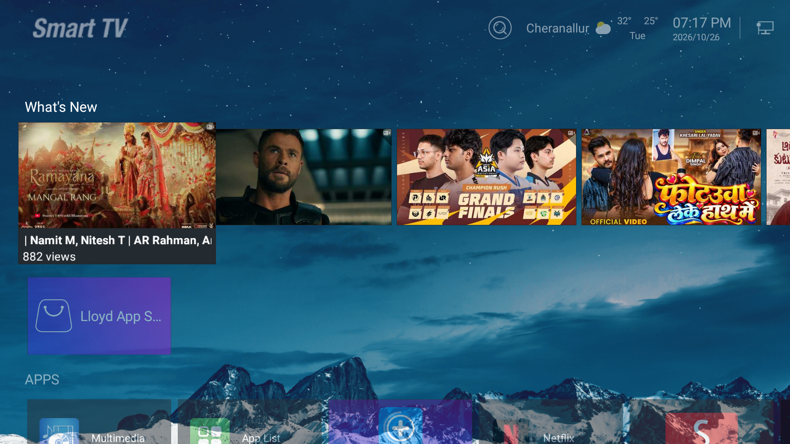
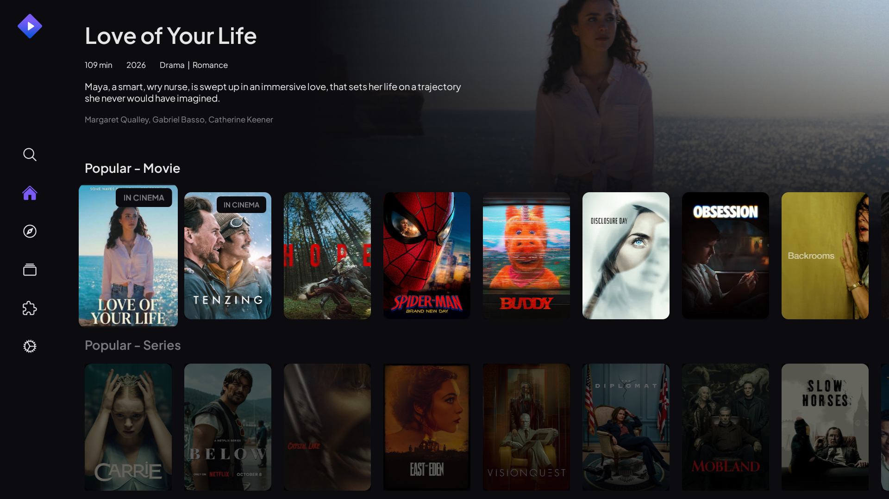

# CleanYourOldTV ⚡📺

> Speed up budget Android TVs (1GB RAM or less) over local Wi-Fi in under a minute.  
> Instant UI response, safe user-space debloat, on-device web remote with trackpad, and hardware-buffered media playback.

[](LICENSE)
[](#supported-tvs)
[](docs/SAFETY_AND_CVTE_GUIDE.md)

---

## Overview

Budget smart TVs from brands like Lloyd, Xiaomi, TCL, Realme, OnePlus, Thomson, Vu, Kodak, Blaupunkt, and Daiwa typically ship with 1 GB or less of physical RAM.

Over time, background telemetry and default OS animation transitions cause noticeable interface lag:
* Remote button presses take several seconds to register.
* Typing search queries and credentials using an infrared remote is slow and prone to errors.
* Video streams at higher resolutions cause memory starvation or decoder crashes on older MediaTek and Amlogic chipsets.
* Standard debloat scripts often disable system launchers or core services, breaking physical Cable TV tuner controls or causing boot hangs.

CleanYourOldTV addresses these issues directly over local Wi-Fi. It requires no root privileges, removes no system files, and includes an automated restore script.

---

## Feature Comparison

| Problem | CleanYourOldTV Solution |
| :--- | :--- |
| **Menu Transition Delays** | Global window and transition animation scales are set to `0.0x` for instant navigation. |
| **Background Memory Usage** | Unused OEM test packages, print spoolers, and crash telemetry are safely frozen in user space. |
| **Physical Remote Limitations** | A lightweight web server runs directly on the TV (24 KB RAM usage), accessible via phone browser. |
| **App Navigation Without Mouse** | The web remote provides a precision trackpad with acceleration and micro-nudge directional controls. |
| **On-Screen Keyboard Entry** | Text can be typed on a phone keyboard and sent directly to the TV input field. |
| **Free Media Streaming** | Configures Stremio with Torrentio and Anime Kitsu addons, routed through VLC hardware buffering. |
| **Cable TV and Tuner Inputs** | The factory launcher is left completely intact, preserving tuner switching on physical remotes. |
| **Safe Rollback** | `RESTORE_FACTORY.bat` re-enables all disabled packages and restores default animation scales. |

---

## Screenshots

<p align="center">
  
  
</p>

---

## Pre-Flight Checklist

Before running the setup script, verify the following:

1. **Same Local Network**: Both your computer (or phone) and the TV must be connected to the same Wi-Fi router or Ethernet switch. Do not use Guest Wi-Fi, as client isolation prevents devices from communicating.
2. **Disable VPN**: Turn off any active VPN (NordVPN, ExpressVPN, Surfshark, Cloudflare WARP) on your computer or phone. VPN tunnels prevent local subnet discovery.
3. **Power State**: The TV screen must be powered on and showing the home menu.
4. **Authorization Dialog**: When connecting for the first time, your TV will display an authorization prompt:
   ```text
   Allow USB debugging?
   The computer's RSA key fingerprint is: ...
   ```
   Check the box for **Always allow from this computer** using your physical TV remote and click **OK**.

---

## Quickstart

### Step 1: Locate TV IP Address and Enable Debugging

#### Finding the IP Address
* **Android TV / Google TV**: Open Settings -> Network & Internet -> Select your connected Wi-Fi -> IP Address (e.g. `192.168.1.50`).
* **Fire TV**: Open Settings -> My Fire TV -> About -> Network -> IP Address.
* **Router Interface**: Check the DHCP client list in your router settings at `192.168.1.1`.

#### Enabling Debugging on Your TV
* **Method 0: Test Direct Connection (Many Budget TVs)**:  
  Many budget TVs ship with network debugging enabled on port 5555 out of the box. Try entering your IP directly in the script.
* **Method 1: Standard Developer Mode (Google TV, Sony, Mi, TCL, Realme, OnePlus)**:  
  Open Settings -> About -> Scroll down to Build Number -> Press OK 7 times -> Go to Settings -> Developer Options -> Enable USB Debugging.
* **Method 2: Factory Remote Codes (Older Budget TVs)**:  
  If pressing OK 7 times does not open Developer Options, press Menu on your remote and enter `1147`, `2580`, or `815`. Locate General Settings and enable ADB.

For LG webOS or Samsung Tizen instructions, refer to the [Platform Guide](docs/BRANDS_AND_PLATFORMS.md).

---

### Step 2: Run the Optimization Script

#### Windows
1. Download the [Repository ZIP](https://github.com/gauthamkrishnars/cleanyouroldtv/archive/refs/heads/main.zip) and extract it.
2. If ADB is not installed on your system, install it via winget (`winget install Google.PlatformTools`) or download Google Platform-Tools and place `adb.exe` in this folder.
3. Double-click `RUN_OPTIMIZER.bat`.
4. Enter the TV IP address when prompted (or accept auto-detected device).
5. Choose what you want to configure:
   * `[1] Optimize TV Only`: Sets 0.0x animation scaling and disables background telemetry.
   * `[2] Install 24/7 Phone Remote Only`: Installs the zero-RAM web remote with touchpad and keyboard.
   * `[3] Free Streaming Setup Only`: Auto-injects Torrentio and Anime Kitsu addons into Stremio.
   * `[4] Everything`: Recommended default that runs all of the above.

#### macOS and Linux
```bash
chmod +x run_optimizer.sh
./run_optimizer.sh
```

#### Android Phone (Without a Computer)
1. Install **Termux** from F-Droid or GitHub.
2. Run the following commands:
   ```bash
   pkg install android-tools git
   git clone https://github.com/gauthamkrishnars/cleanyouroldtv.git
   cd cleanyouroldtv
   chmod +x run_optimizer.sh
   ./run_optimizer.sh
   ```

---

### Step 3: Connect to the Web Remote

Once optimization finishes, open a browser on any phone connected to the same Wi-Fi and navigate to:

```text
http://<YOUR-TV-IP>:8080
```
Example: `http://192.168.1.50:8080` (use your TV's actual IP address).

To install it as an app on your phone, open your browser options and select **Add to Home Screen**.

---

## Technical Details

### On-Device Web Server Architecture

The web remote runs directly on the television without requiring a host computer:

```text
[ TV Cold Boot ]
       │
       ▼
 [ TVRemoteBoot.apk ]    (8 KB background receiver catches BOOT_COMPLETED)
       │                 (Starts local daemon, then terminates process)
       ▼
[ BusyBox httpd:8080 ]  (Micro web server consuming ~24 KB RAM)
       │
       ▼
  [ key.cgi ]           (Dispatches Linux input events to /dev/input/event2)
       │
[ Mobile Web Client ]   (Touchpad, D-pad, keyboard, and task management)
```

* **Memory Footprint**: The BusyBox HTTP service uses approximately 24 KB of memory, leaving the remaining RAM available for media applications.
* **Kernel Event Dispatch**: Button and pointer actions call `/cgi-bin/key.cgi`, writing input codes directly to Linux event nodes for minimal latency.
* **RAM Cleanup**: The web interface includes a button to trigger `drop_caches` and terminate background processes before launching heavy media tasks.

---

## Free Streaming Stack (Stremio and VLC)

Budget and older Android TVs frequently have broken, deprecated, or uncertified app stores where modern streaming apps are unavailable. To avoid using USB thumb drives or struggling with obsolete stores, CleanYourOldTV supports wireless sideloading directly over ADB.

1. **Obtaining Stremio and VLC APKs**:
   * Stremio Android TV (`com.stremio.one`): Download the official ARM APK from `stremio.com/download` (save as `Stremio_TV.apk`).
   * VLC for Android (`org.videolan.vlc`): Download the official ARM APK from `get.videolan.org/vlc-android` (save as `vlc.apk`).
   * If you place `Stremio_TV.apk` and `vlc.apk` inside the project folder, the script will automatically sideload and install them to your TV over Wi-Fi. Alternatively, install them manually using `adb install -r <apk_name>`.
2. **Automatic Addon Configuration**:
   * Open Stremio on your TV and log in with a free account once so your addon preferences persist.
   * Run `RUN_OPTIMIZER.bat` (Option 3 or 4) or tap **Free Media** on your mobile web remote.
   * The script dispatches deep-link intents to register the **Torrentio** (Movies and Series) and **Anime Kitsu** (Anime) addon manifests automatically.
3. **Hardware Playback Settings**:
   * In Stremio Settings -> Streaming, exclude `4k` streams. Older decoders like the MediaTek MT5863 cannot process 4K HEVC streams smoothly.
   * Set Default Player to **External Player** (VLC).
   * In VLC Settings -> Advanced, set **Network Caching Value** to `3,000 ms`. This ensures smooth playback and eliminates buffering drops.

---

## Rollback Instructions

All package modifications use user-space disabling (`pm disable-user --user 0`). No system partitions are modified.

To restore factory settings:
* **Windows**: Double-click `RESTORE_FACTORY.bat`.
* **macOS / Linux**: Run `./restore_factory.sh`.

The restore script:
1. Re-enables all frozen packages.
2. Resets animation scales back to `1.0x`.
3. Terminates the BusyBox HTTP process and removes the `TVRemoteBoot` helper.

---

## Documentation

* [Brands and Platforms Guide (Android TV, Fire TV, LG webOS, Samsung Tizen)](docs/BRANDS_AND_PLATFORMS.md)
* [Safety Architecture and CVTE Motherboard Notes](docs/SAFETY_AND_CVTE_GUIDE.md)
* [Manual Command Reference](docs/MANUAL_COMMANDS.md)

---

## License

This project is licensed under the [MIT License](LICENSE).
