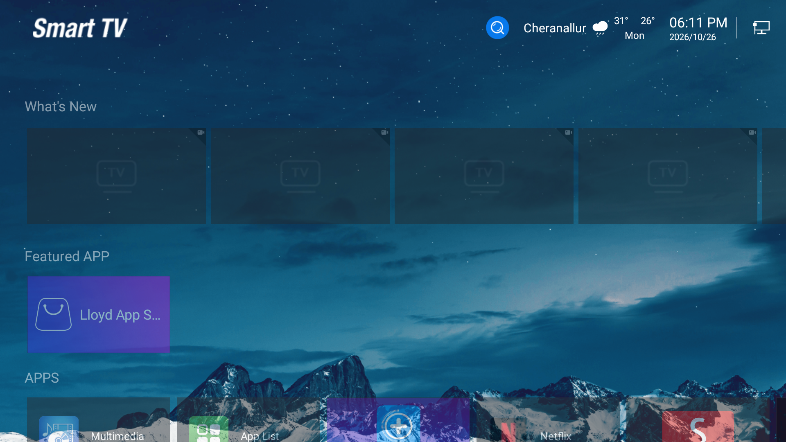
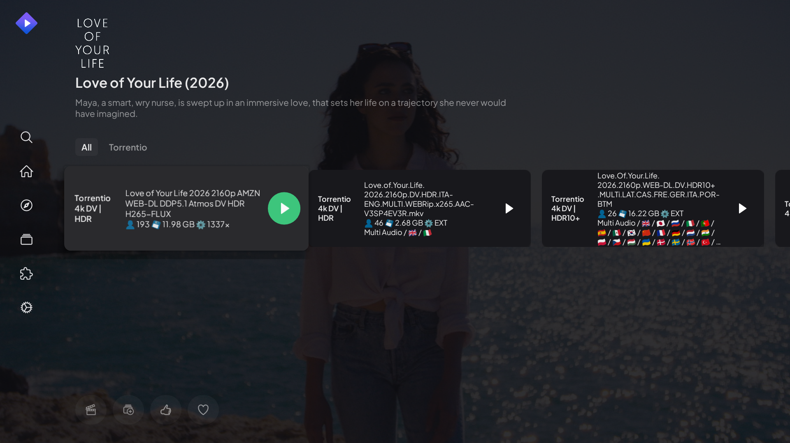
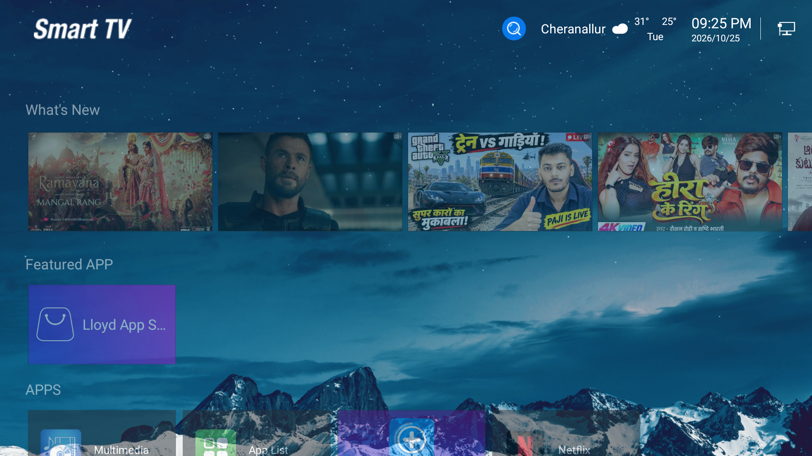

# CleanYourOldTV ⚡📺

> **Resurrect any sluggish budget Smart TV over Wi-Fi in 60 seconds.**  
> Instant Menu Response · Safe Background Debloat · 24/7 Phone Remote with Touchpad · Stutter-Free Streaming · 100% Risk-Free.

[](LICENSE)
[](#supported-tvs)
[](docs/SAFETY_AND_CVTE_GUIDE.md)

---

## 🛑 The Problem with Budget & Older Smart TVs

Millions of budget smart TVs (such as **Lloyd, Xiaomi/Mi, TCL, Realme, OnePlus, Thomson, Vu, Kodak, Blaupunkt, Daiwa, Hisense, and generic Android TVs**) ship with **only 1 GB or less of RAM**.

After a year or two of updates and usage, they slow down to a crawl:
* 🐢 **Agonizing UI Lag**: Pressing buttons on the remote takes seconds to respond because slow fade animations choke the TV processor.
* ⌨️ **Typing Torture**: Searching on YouTube or typing Wi-Fi passwords with a sluggish plastic remote is agonizing.
* 💥 **App Freezes & Decoder Crashes**: When streaming apps attempt high-bitrate video, older TV chips overheat or crash to a black screen.
* ⚠️ **Generic Guides Break Cable TV**: Many online tutorials tell you to replace the launcher or delete system packages—which breaks your physical remote's Cable TV tuner button or traps your TV in an infinite bootloop!

**CleanYourOldTV** fixes all of this with **no cables, no root, zero risk, and a 1-click restore**.

---

## ✨ What This Toolkit Does For Your TV

| What Annoyed You | What CleanYourOldTV Fixes |
| :--- | :--- |
| **Laggy Home & Settings Menus** | **Instant responsiveness**: Animation delays set to `0.0x` so menus snap open immediately. |
| **Hidden Factory Telemetry & Bloat** | **Freed RAM**: Freezes background crash-tracking and OEM test shims safely in user-space. |
| **Lost or Sluggish Plastic Remote** | **24/7 On-TV Web Remote**: Runs directly on the TV using only 24 KB RAM. Accessible from any phone browser on Wi-Fi. |
| **No Mouse for Sideloaded Apps** | **Laptop-style Trackpad**: Full touch cursor with micro-nudge arrows for precision aiming. |
| **Slow On-Screen Typing** | **Direct Phone Typing**: Type passwords, movie titles, and links straight from your phone's keyboard. |
| **Family Cable TV Compatibility** | **100% Intact**: Keeps your factory TV launcher untouched so Cable TV and physical remote buttons never break. |
| **Video Playback Stuttering** | **Hardware Buffer Optimization**: Pre-configures video caching so movies play smoothly without buffering. |
| **Peace of Mind** | **1-Click Rollback**: Run `RESTORE_FACTORY.bat` at any time to return 100% back to factory default in 5 seconds. |

---

## 📸 Screenshots

<p align="center">
  
  
</p>

<p align="center">
  
  
</p>

---

## ⚠️ Crucial Checklist Before You Start (Don't Skip!)

To make sure your connection works on the first try without any issues, check these 4 points:

1. 📶 **Same Wi-Fi / Router**: Your computer (or phone) and your TV **MUST be connected to the exact same Wi-Fi network or router**.
   * *Watch out*: If your computer is on a "Guest Wi-Fi" or mobile hotspot, devices cannot talk to each other. Connect both to your main home Wi-Fi!
2. 🛡️ **Turn OFF Any VPN**: If you have a VPN running on your computer or phone (like NordVPN, ExpressVPN, Surfshark, or Cloudflare 1.1.1.1 WARP), **turn it OFF temporarily**. VPNs block local network communication.
3. 📺 **Keep TV Awake**: Make sure your TV screen is turned **ON** and showing the home screen (not asleep or in standby mode).
4. 🔑 **Look at Your TV Screen for the Permission Popup**:
   * The first time you connect, a dialog will appear on your TV screen:  
     `"Allow USB debugging? The computer's RSA key fingerprint is: ..."`
   * **You MUST use your physical TV remote to check `[X] Always allow from this computer` and click `OK`!**

---

## 🚀 Quickstart: 3 Simple Steps

### Step 1: Find Your TV's IP & Enable Debugging

#### Where to Find Your TV's IP Address:
* **Android TV / Google TV**: Open TV **Settings** $\rightarrow$ **Network & Internet** $\rightarrow$ Click on your **Connected Wi-Fi** $\rightarrow$ Scroll down to **IP Address** (e.g. `192.168.1.50`).
* **Fire TV**: Open **Settings** $\rightarrow$ **My Fire TV** $\rightarrow$ **About** $\rightarrow$ **Network** $\rightarrow$ **IP Address**.
* **Router Admin Page**: Open your browser at `192.168.1.1` and look at connected devices.

---

#### How to Enable Network Debugging (Choose the method that matches your TV):

* **Method 0: Just Try Connecting Right Away! (Most Budget TVs)**  
  On millions of budget smart TVs (Lloyd, Thomson, Kodak, Vu, Daiwa, Blaupunkt), **Network Debugging is already enabled by default from the factory**. Try running the script directly with your TV's IP! If it connects, you don't have to touch any developer menus.

* **Method 1: Standard "7 Clicks" Method (Google TV, Sony, Mi, TCL, Realme, OnePlus)**  
  1. Open TV **Settings** $\rightarrow$ **Device Preferences** (or **System**) $\rightarrow$ **About**.  
  2. Find **Android TV OS Build** (or **Build Number**).  
  3. Press the **OK button on your TV remote 7 times rapidly** until a message says: *"You are now a developer!"*  
  4. Press Back $\rightarrow$ Open **Developer Options** $\rightarrow$ Turn **ON** `USB Debugging` and `Network Debugging`.

* **Method 2: Secret Remote Codes (If 7 clicks does nothing on your TV)**  
  Some older budget TV remotes lock developer settings behind an engineering code:  
  * Press **`Menu`** (or `Source` / `Input`) on your TV remote, then quickly press:  
    **`1 1 4 7`** (Most common) or **`2 5 8 0`** or **`8 1 5`**.  
  * In the secret menu that appears, go to *General Settings* and toggle **ADB Debugging ON**.

*(Have an **LG webOS** or **Samsung Tizen** TV? See our [Non-Android TV Guide](docs/BRANDS_AND_PLATFORMS.md) for speedup and debloat steps!).*

---

### Step 2: Run the 1-Click Script

#### 🪟 On Windows (Easiest)
1. Download this repository ([Click here to download ZIP](https://github.com/gauthamkrishnars/cleanyouroldtv/archive/refs/heads/main.zip)) and extract it.
2. Double-click **`RUN_OPTIMIZER.bat`**.
3. Type your TV's IP address (e.g. `192.168.1.50`) when prompted, or let it auto-detect.
4. **Look at your TV screen**: If prompted with *"Allow USB debugging?"*, check `Always allow` and click `OK` with your TV remote.
5. **Hands off!** The script automatically creates a package backup, sets instant animations, freezes background telemetry, and launches your phone remote.

#### 🍏 On macOS / 🐧 Linux
Open terminal in the folder and run:
```bash
chmod +x run_optimizer.sh
./run_optimizer.sh
```

#### 📱 100% Phone-Only (No PC or Laptop Needed!)
If you don't own a computer, you can run this entire optimization directly from an Android smartphone over Wi-Fi:
1. Connect your phone to your home Wi-Fi.
2. Install the free **Termux** app (from F-Droid or GitHub) or **Bugjaeger Mobile ADB** from Google Play.
3. In Termux, run:
   ```bash
   pkg install android-tools git
   git clone https://github.com/gauthamkrishnars/cleanyouroldtv.git
   cd cleanyouroldtv
   chmod +x run_optimizer.sh
   ./run_optimizer.sh
   ```

---

### Step 3: Open Your 24/7 Phone Remote!

Once the script finishes, open your smartphone browser on your home Wi-Fi and visit:

```text
http://<YOUR-TV-IP>:8080
```
*(Example: `http://192.168.1.50:8080` — replace with your TV's actual IP address)*

> 📱 **Add to Phone Home Screen**: In Safari (iOS) or Chrome (Android) on your phone, tap **Share / Settings $\rightarrow$ Add to Home Screen**. It installs as a full-screen native app with an icon for instant, full-screen remote control anytime!

---

## 🕹️ Standalone 24/7 On-TV Web Remote

Unlike other remote apps that force you to keep a computer running or install ad-heavy apps from the Play Store, this remote **lives 100% inside your TV**:

```text
[ TV Powers On at Wall Socket ]
               │
               ▼
      [ TVRemoteBoot.apk ]     <-- 8 KB receiver catches power-on broadcast
               │                   Starts micro-daemon via root socket, then exits
               ▼
       [ BusyBox httpd ]       <-- Built-in micro web server (Only 24 KB RAM!)
               │
               ▼
          [ key.cgi ]          <-- Injects events straight to hardware input kernel
               │
        [ Phone Web UI ]       <-- Served directly to any smartphone browser on Wi-Fi
```

### Remote Highlights:
* **D-Pad & Trackpad Modes**: Seamless toggle between traditional TV D-Pad buttons and a smooth laptop-style mouse trackpad.
* **Sensitivity Controls**: Toggle between **Fine**, **Normal**, and **Fast** pointer speeds.
* **Micro-Nudge Precision**: Arrow buttons (`▲`, `◀`, `▶`, `▼`) for pixel-perfect clicking on small buttons.
* **Instant Phone Keyboard**: Type searches, movie names, and long passwords from your phone keyboard instead of clicking one letter at a time on screen.
* **🧹 Close All Apps / Purge RAM**: Single button that terminates background applications and cleans cached memory (`drop_caches`), giving you maximum free RAM before playing games or launching heavy apps.

---

## 🍿 Recommended Streaming Setup (Zero Stutter)

If your TV has limited RAM or an older MediaTek processor, here is the battle-tested streaming combination:

1. **Stremio for Android TV** (`com.stremio.one`):
   * In **Settings $\rightarrow$ Streaming**, exclude `4k` (budget TV decoders lock up on 4K files).
   * Set **Default Player** to **External Player**.
2. **VLC for Android** (`org.videolan.vlc`):
   * In **Settings $\rightarrow$ Advanced**, set **Network Caching** to `3,000 ms`.
   * **Result**: Zero video stutter, instant playback scrubbing, and zero UI lockup.

---

## 🛡️ Strict Safety Guarantee & 1-Click Rollback

* **No Bricking Hazard**: Operates strictly in user-space (`/data`). System partitions are never remounted.
* **Google Play Services Preserved**: We never disable `com.google.android.gms` (which causes cold-boot hangs on older Android builds).
* **Tuner & Remote Safe**: Your stock launcher is kept intact, meaning Cable TV and your physical remote's Source/Home buttons work exactly as they always did.
* **Safe Freezing**: Uses `pm disable-user --user 0`. No system files are permanently deleted.

### How to Undo (1-Click Factory Restore)
Want to return 100% back to factory default?
* On Windows: Double-click **`RESTORE_FACTORY.bat`**.
* On Linux/Mac: Run `./restore_factory.sh`.

---

## 📚 Deep Guides & Documentation
* [Universal Brands & Platforms Guide (Android TV, Fire TV, LG webOS, Samsung Tizen)](docs/BRANDS_AND_PLATFORMS.md)
* [Safety Architecture & Hardware Lessons](docs/SAFETY_AND_CVTE_GUIDE.md)
* [Manual Step-by-Step Commands (For Power Users)](docs/MANUAL_COMMANDS.md)

---

## ⚖️ License
This project is open-source and free under the [MIT License](LICENSE).
